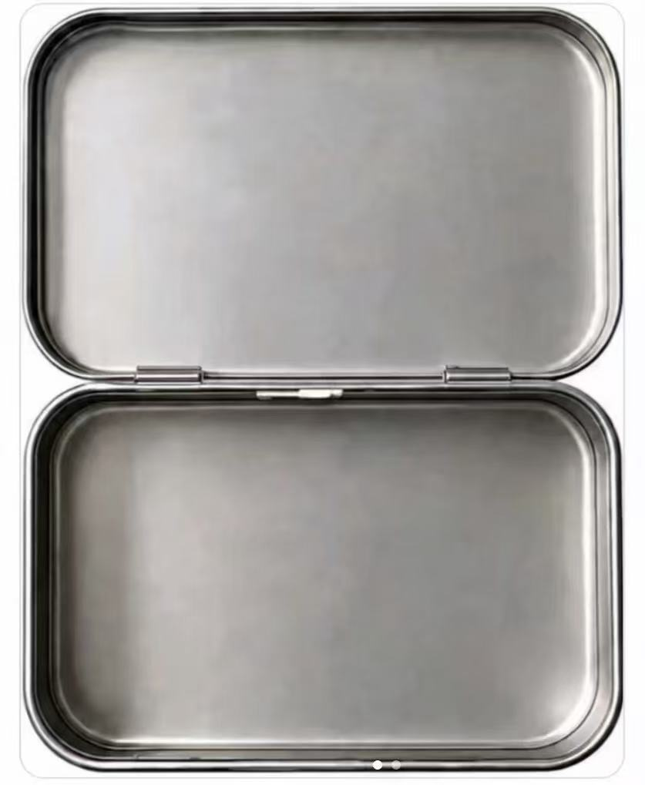
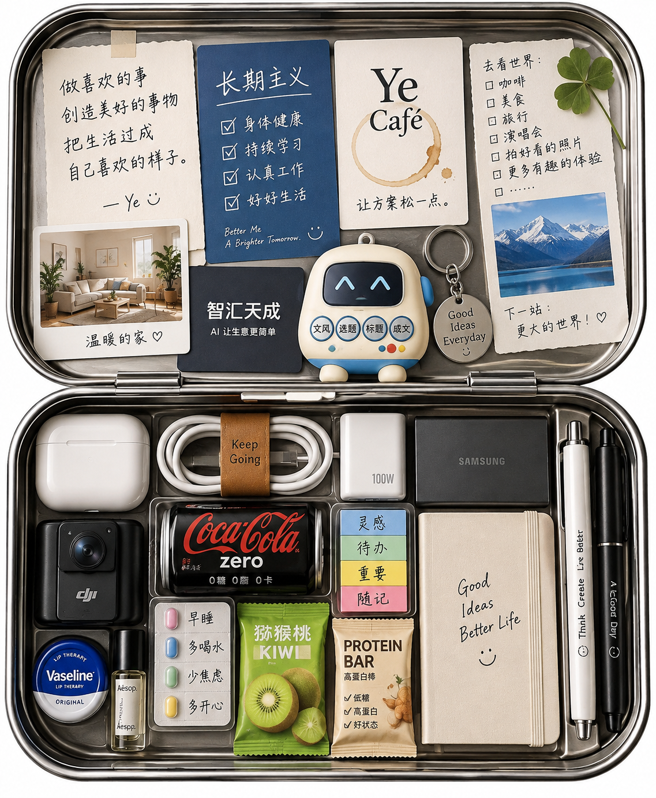
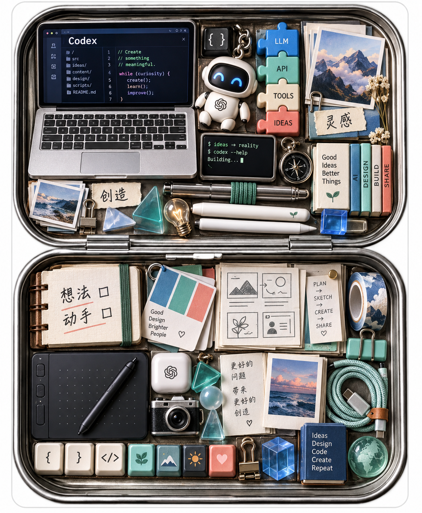

# 我的理想生活随身盒

以打开的双面金属盒为容器，用一句提示词让 AI 根据已有个人上下文填满两面；保留容器原图，以及 ChatGPT 与 Codex 的两份生成结果。

- 分类：提示词
- 收藏日期：2026-10-19
- 标签：个性化创作、容器填充、生活随身盒、ChatGPT、Codex
- 主题：个性化图像提示词、容器式构图、生成结果对照

## 参考图



图 1 · 容器原图

## 生成结果



图 2 · ChatGPT 生成



图 3 · Codex 生成

## 提示词

```text
根据你知道的关于我的一切，把这个容器两面都填满。
```

## 收藏备注

归档方式：一条提示词收藏，包含 1 张容器原图与 2 张生成结果，不拆分为图片收藏。

生成来源：图 2 由 ChatGPT 生成，图 3 由 Codex 生成（按用户说明标注）；具体模型版本未提供。

画面观察：ChatGPT 结果围绕日常随身物件、生活愿望和旅行照片展开；Codex 结果围绕编程、设计、创作与工具展开。两张结果均以打开的金属盒为边界，把物件、纸条和图像密集排入两面。

复用方法（整理笔记）：在已有个人上下文的对话中上传容器参考图，发送原提示词；可对照不同应用对上下文的理解与画面组织。

来源：提示词与三张图片均由用户提供；原文和原图完整保留，未改写、裁切或转换。

[返回全部收藏](./index.md) · [读取 JSON](../api/items/ideal-life-container-prompt-20261019.json)
