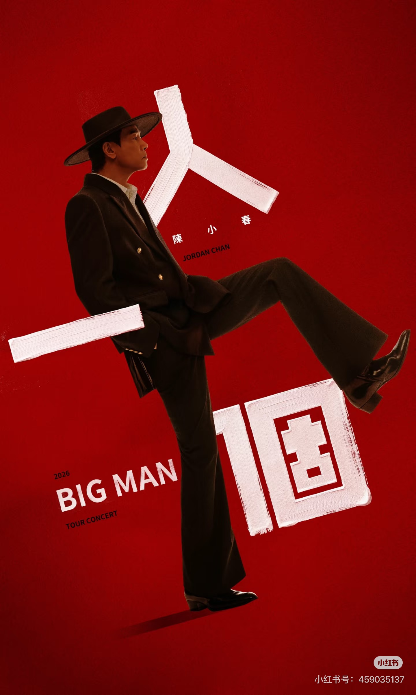
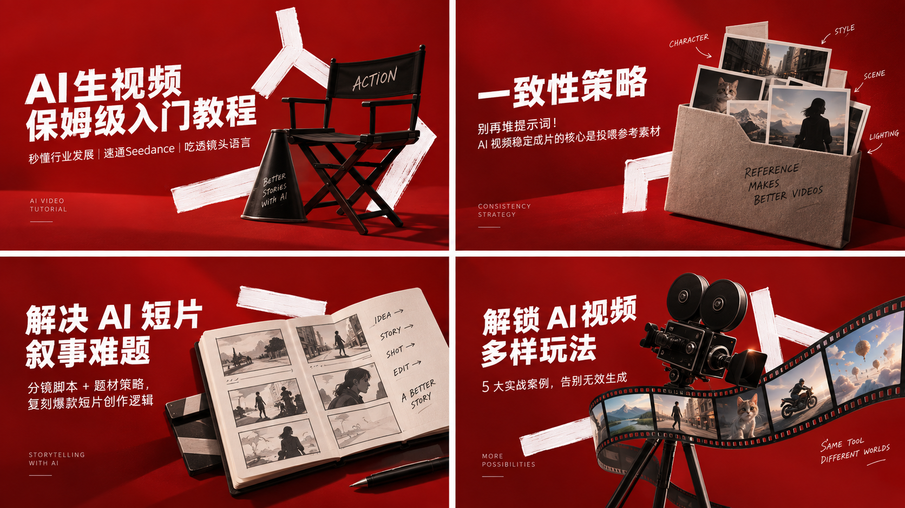
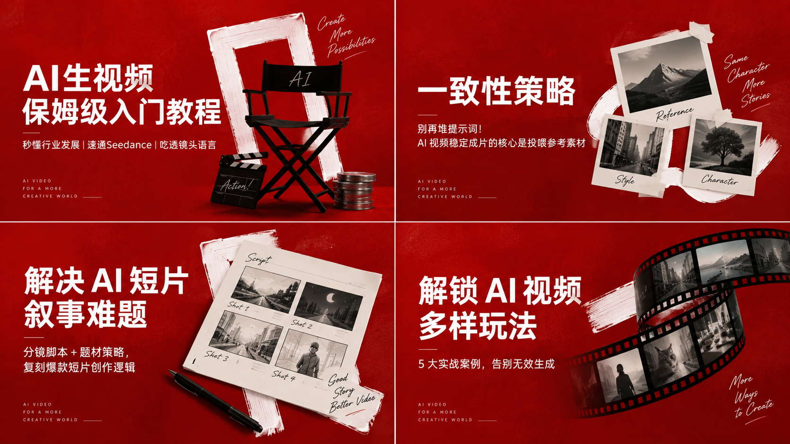
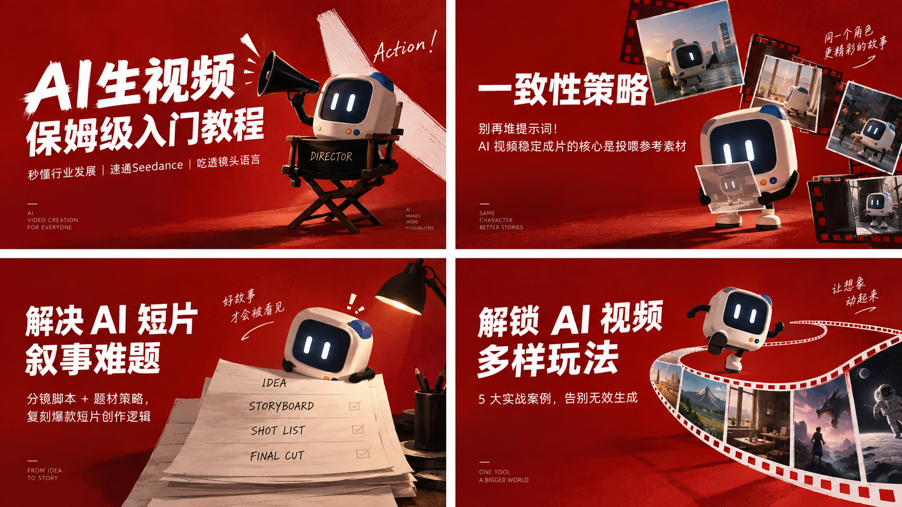

# 红色笔刷风格 · AI 视频教程系列封面

一张演唱会宣传海报风格参考与三组 AI 视频教程系列封面生成结果。保留红色纹理、白色笔刷和大字标题的系列语言，对照电影物件、参考卡片与分镜、机器人角色三种构图方向。

- 分类：风格化图片
- 收藏日期：2026-10-18
- 标签：红色系、笔刷质感、系列封面、AI 视频、海报设计
- 主题：AI 视频教程、系列视觉设计、封面提示词
- 使用模型：GPT 5\.6 Sol

## 参考图



图 1 · 风格参考

## 生成结果



图 2 · 生成结果 01



图 3 · 生成结果 02



图 4 · 生成结果 03

## 提示词原文

```text
参考我给到的图（不要有真人），生成4张图，4张图的文本一依次如下（只需要主标题和副标题的具体内容，不需要序号1234 页不需要“主标题””副标题“），4张图不用刻意保持公式化的一致，这样会呆板。4张图可以适当“各自精彩”，需要在视觉上看起来是一个系列即可。 封面图的尺寸，按照微信公众号的封面来定。  1 主标题 AI生视频保姆级入门教程 副标题 秒懂行业发展｜速通Seedance｜吃透镜头语言  2 主标题 一致性策略 副标题 别再堆提示词！AI 视频稳定成片的核心是投喂参考素材  3 主标题 解决 AI 短片叙事难题 副标题 分镜脚本 + 题材策略，复刻爆款短片创作逻辑  4 主标题 解锁 AI 视频多样玩法 副标题 5 大实战案例，告别无效生成
```

## 收藏备注

归档方式：1 张风格参考图与 3 张生成结果合并为一条收藏；每张生成结果均为四格拼图。

风格观察：深饱和红色纹理背景、白色宽笔刷、大号无衬线标题，搭配导演椅、摄影机、胶片等电影道具；第三组加入机器人角色。三组结果延续同一视觉语言，同时变化道具与构图。

复用方向（整理笔记）：可用于对照系列一致性与版式变化，参考同一套配色、笔刷和标题语言，发展不同主题的封面。

生成记录：使用模型为 GPT 5\.6 Sol（按用户提供信息记录）。完整提示词逐字保留，未改写。

来源：图片与提示词由用户提供；参考图的原始链接、作者与授权信息未另附。原图内标识保持原样，收藏不附加新的授权许可。

[返回全部收藏](./index.md) · [读取 JSON](../api/items/red-brush-ai-video-covers-20261018.json)
